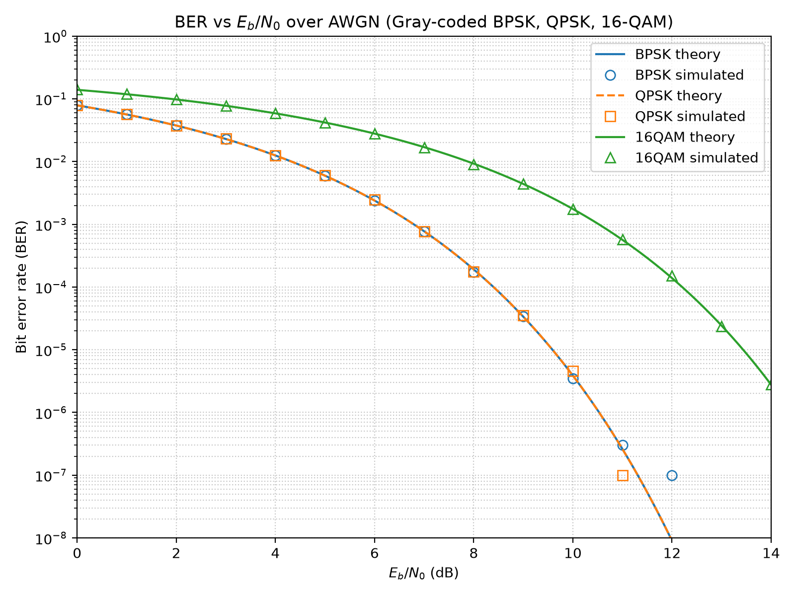

# BER vs SNR Simulator: BPSK, QPSK and 16-QAM over AWGN

A small Monte Carlo simulator in Python that measures the bit error rate (BER) of Gray-coded
BPSK, QPSK and 16-QAM over an additive white Gaussian noise (AWGN) channel and compares it with
the theoretical curves.

## Features

- Gray-coded **BPSK, QPSK and 16-QAM** mappers with unit average symbol energy
- Hard-decision (minimum-distance) demodulators
- AWGN channel with noise variance set correctly from **Eb/N0** (accounts for bits per symbol)
- Monte Carlo BER for Eb/N0 = 0 to 14 dB. Each point runs until it has at least 100 errors or
  hits the maximum bit count
- Fixed random seed, so every run gives the same results
- Theoretical BER using the Q-function / `erfc`
- Fully vectorized NumPy (no per-bit Python loops). The full run takes about 20 s
- pytest suite: roundtrip, symbol energy, Gray coding, noise variance, and simulated BER vs theory
- Theory notes with worked examples in [NOTES.md](NOTES.md)

## Results



Markers are simulated and lines are theory. Raw numbers are in
[`results/ber_results.csv`](results/ber_results.csv). Points with zero errors after the maximum
bit count (10⁷ by default) are left off the plot. Points with only a few errors at high SNR are
noisy estimates.

## Project structure

```
ber-awgn-simulator/
├── src/
│   ├── modulation.py   # Gray-coded mappers / hard-decision demappers
│   ├── channel.py      # AWGN channel, Eb/N0 -> N0
│   ├── theory.py       # Q-function and theoretical BER
│   ├── simulate.py     # Monte Carlo BER engine
│   └── main.py         # CLI: run simulation, save CSV + plot
├── tests/
│   ├── test_modulation.py
│   └── test_ber.py
├── results/
│   ├── ber_curves.png
│   └── ber_results.csv
├── NOTES.md
├── requirements.txt
├── pytest.ini
├── LICENSE
└── README.md
```

## Installation

Requires Python 3.10+ (tested with 3.14).

```bash
python -m venv .venv
source .venv/bin/activate        # Windows: .venv\Scripts\activate
pip install -r requirements.txt
```

## Usage

```bash
python -m src.main
```

Optional arguments:

```bash
python -m src.main --min-errors 200 --max-bits 50000000 --seed 7
```

## Running tests

```bash
pytest
```

## What I learned

_TODO: fill this in._

## License

MIT. See [LICENSE](LICENSE).
